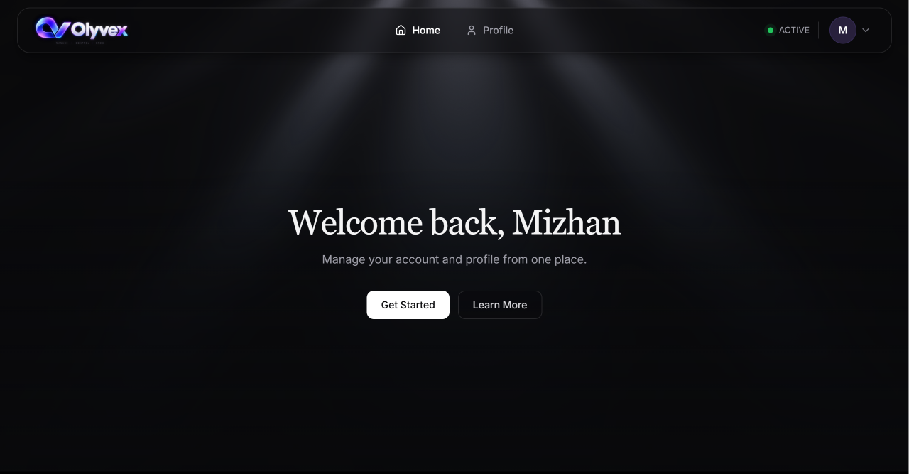
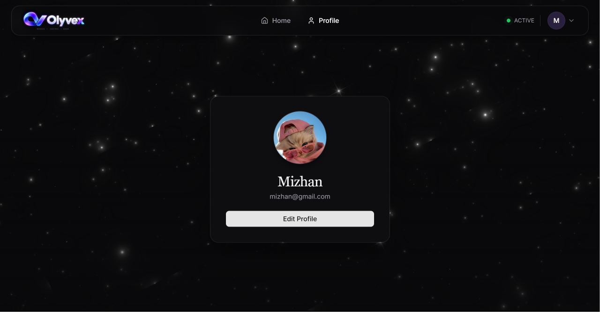
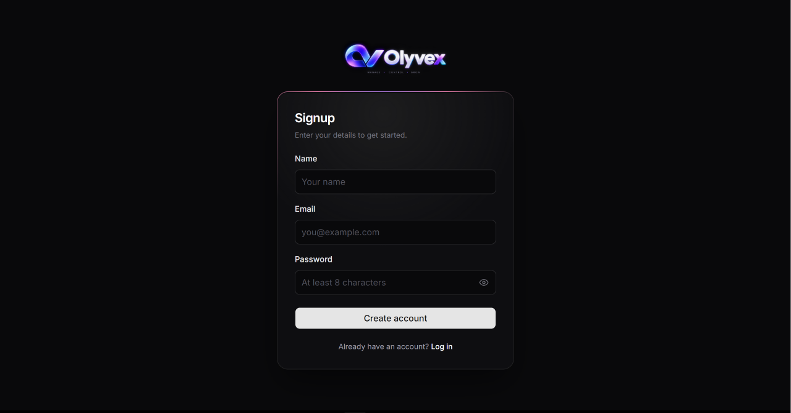
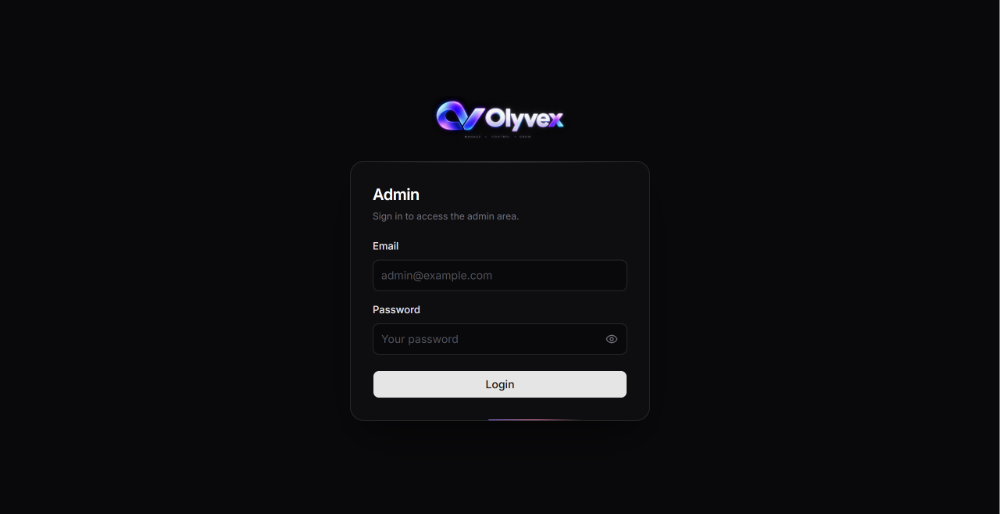
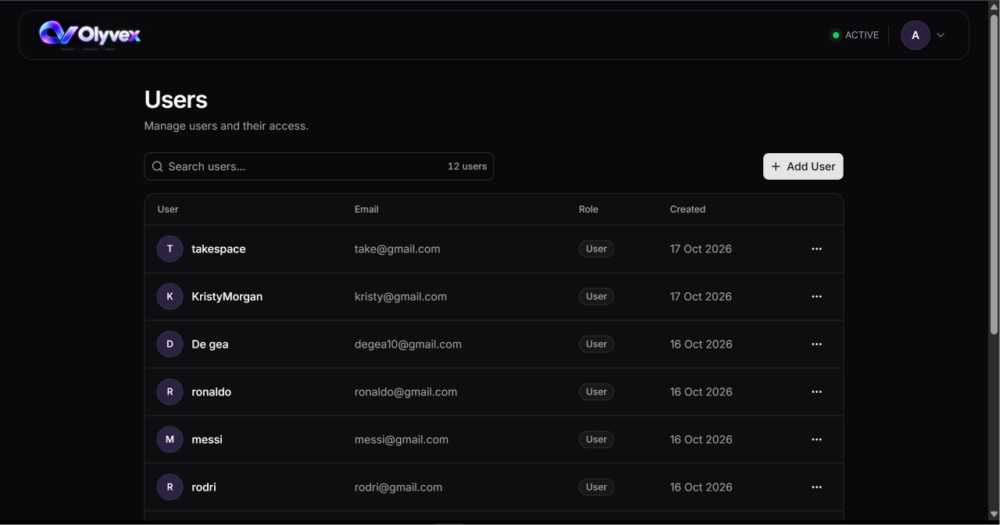

 

# ◈ Olyvex

**A full-stack user management application with secure authentication, profile management, and an admin dashboard — powered by React, TypeScript, Redux Toolkit, Express, and MongoDB.**

 

  

## Preview

  
  

  
  

  

 

## ✨ Highlights

- 🔐 **Authentication & Authorization** — JWT-based authentication with access and refresh tokens.
- 👤 **User Profiles** — View and update profile information, including profile images.
- 🛡️ **Protected Routes** — Separate route protection for authenticated users and administrators.
- 👨‍💻 **Admin Dashboard** — Manage users with create, update, and delete operations.
- 🔎 **Search & Pagination** — Search users with server-side pagination.
- ✅ **Form Validation** — Type-safe validation using React Hook Form and Zod.
- 🔄 **Session Restoration** — Restore authentication sessions after page reloads.
- 📱 **Responsive UI** — A modern interface with interactive animations.

 

## 🛠️ Tech Stack

**Frontend**
- React
- TypeScript
- Vite
- Redux Toolkit — State management
- React Router — Client-side routing
- Axios — API requests
- React Hook Form & Zod — Form handling and validation

**Backend**
- Node.js
- Express
- TypeScript
- Zod — Request validation
- JWT — Authentication

**Database**
- MongoDB
- Mongoose — Object data modeling

**Additional Tools**
- Cloudinary — Profile image management

 

## 🔒 Authentication

Olyvex uses access and refresh tokens to manage authenticated sessions.

- Access tokens are maintained in Redux state and used for authenticated API requests.
- Refresh tokens are handled through HTTP-only cookies.
- Protected routes restrict access to pages that require authentication or administrator privileges.
- Session restoration allows valid sessions to continue after a page reload.

 

**Built with ❤️ using React, TypeScript, Node.js, Express, and MongoDB**

